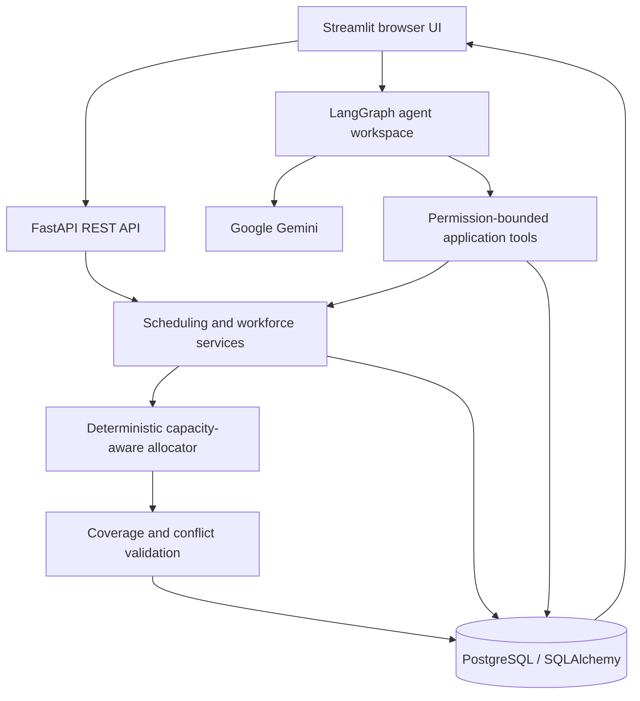

# RosterOps — Smart Roster Management System

**DataStraw Tech Internship Assessment · Workforce scheduling + Agentic AI**

RosterOps is a browser-based workforce planning application for multi-brand operations teams. It combines a deterministic, capacity-aware resource allocator with a LangGraph tool-using operations assistant. The application is designed around one principle: **reliable scheduling and accurate coverage are authoritative; AI investigates, explains, and recommends; a human manager approves consequential changes.**

## What is implemented

### Assessment workflows
- Workforce, pod, brand, process, and employee-to-process assignment data models.
- 32 employees, 4 pods, 20 brands, and mixed single-/multi-resource sample patterns.
- Brand and process operating modes: 365 days, daily except public holidays, and weekdays except Sundays/public holidays.
- Process minimum staffing plus configurable process/brand and day-of-week coverage overrides.
- Approved leave, public holidays, preferred weekly offs, and per-employee daily workload capacity.
- Monthly roster generation with concrete employee → brand → process → date allocations.
- Coverage validation and structured conflict diagnostics.
- Company, pod, brand, process, and employee roster query API views.
- Manual one-day allocation endpoint with assignment, leave, operating-calendar, and capacity checks.
- Leave impact simulation, pending leave requests, manager approval/rejection, and revalidation.
- Assignment, employee, brand, process, holiday, and coverage-rule creation APIs.

### Agentic operations assistant
The LangGraph assistant is a tool-using agent, not a standalone FAQ bot. Its tools retrieve actual employee, brand, process, roster, coverage, and leave data.

It is designed to proactively investigate operational changes:
1. A manager asks what happens if an employee is absent, or a leave request is submitted.
2. The agent calls the absence-impact tool and retrieves affected assignments and service-days.
3. It checks current capacity and identifies candidate backup resources in the relevant pod.
4. It explains which brands/processes/dates are at risk, the size of the shortage, and the trade-offs.
5. It can create a **pending** leave request, but cannot approve it, assign a backup, or publish a roster autonomously.
6. After an authorized manager approves leave, the deterministic scheduler regenerates and validates every affected month. Coverage gaps include backup recommendations and candidate diagnostics.

Tools include employee/brand lookup, brand coverage, roster generation, employee schedule lookup, conflict explanation, absence impact simulation, backup-resource recommendations, pending leave request creation, and pending-request lookup.

Conversation state uses LangGraph's in-process `MemorySaver` checkpoint. This preserves thread state while the process is running; it is **not durable across container restarts**. Durable Postgres-backed checkpointing is a recommended next hardening step if long-running conversations must survive deployments.

## Scheduling model and assumptions

- A process is the unit of required coverage. Each operating process/day creates a staffing demand.
- A person may cover more than one assigned process on a day, but total workload units cannot exceed their configured `daily_capacity`.
- Approved leave is a hard unavailability constraint.
- Brand/process calendars determine whether coverage is required. A public holiday does not automatically make an employee unavailable for a 365-day service.
- Preferred weekly off is a **soft preference**. The allocator may schedule an employee on that day if coverage requires it; the roster entry records the override in its notes.
- The allocator ranks eligible employees by weekly-off preference, current daily workload, primary-assignment status, and stable employee ID. This is deterministic and explainable, but it is a greedy allocator rather than a global mathematical optimizer. Complex competing schedules may require a CP-SAT/MILP solver in a future iteration.
- Minimum coverage rules can be configured at process/brand and day-of-week granularity. Most-specific matching rule takes precedence.
- Sample dataset uses fictional names and dates. Configure real holidays and client rules before operational use.

## Architecture



## Local setup (Python)

Python 3.11 is recommended.

```bash
python -m venv .venv
# Windows PowerShell: .venv\Scripts\Activate.ps1
# macOS/Linux: source .venv/bin/activate
pip install -r requirements.txt
cp .env.example .env
```

For SQLite local development, leave `DATABASE_URL` unset. The app creates `data/roster_management.db` and seeds sample data when the database is empty.

Terminal 1 — API:

```bash
uvicorn app.main:app --reload --port 8000
```

Terminal 2 — UI:

```bash
streamlit run streamlit_app.py
```

Open `http://localhost:8501`; API docs are at `http://localhost:8000/docs`.

To enable the AI assistant, add a Google AI Studio key to `.env` as `GOOGLE_API_KEY=...`. Without a key, all deterministic scheduling and workforce workflows remain available; the agent workspace reports an error instead of fabricating AI results.

## Docker deployment

1. Copy `.env.example` to `.env`.
2. Set strong, unique `POSTGRES_PASSWORD`, `API_ACCESS_KEY`, and `APP_LOGIN_PASSWORD` values. Add `GOOGLE_API_KEY` if AI features are required.
3. Start the stack:

```bash
docker compose up --build -d
```

4. Open:
   - Frontend: `http://localhost:8501`
   - API: `http://localhost:8000`
   - API docs: `http://localhost:8000/docs`
5. Check health:

```bash
docker compose ps
curl http://localhost:8000/health
```

PostgreSQL data is stored in the named `roster_pgdata` volume. Do not run `docker compose down -v` unless you intentionally want to delete the database volume. All `/api/*` endpoints require `X-API-Key` when `API_ACCESS_KEY` is configured; the Streamlit UI sends this from its environment. Production Streamlit access is gated by a shared `APP_LOGIN_PASSWORD`. This is a demo access gate, not per-user authentication or role-based authorization. In production, terminate TLS at a reverse proxy/load balancer, restrict network access, rotate secrets, and configure backups before using real employee data.

## Main API endpoints

| Method | Endpoint | Purpose |
|---|---|---|
| GET | `/health` | Service/database health |
| GET | `/api/dashboard` | Operational counts |
| GET | `/api/employees`, `/api/brands`, `/api/pods` | Workforce data |
| POST | `/api/employees`, `/api/brands`, `/api/processes`, `/api/assignments` | Create workforce records |
| PUT/DELETE | `/api/assignments/{id}` | Edit/remove assignments |
| POST | `/api/coverage-rules`, `/api/holidays` | Configure coverage and holidays |
| POST | `/api/rosters/generate` | Generate and persist a month |
| GET | `/api/rosters/coverage` | Recompute validation without persisting |
| GET | `/api/rosters/allocations`, `/api/rosters/view` | Read actual allocations and views |
| POST | `/api/impact/leave` | Simulate absence impact without mutation |
| POST | `/api/leave-requests` | Create pending leave request |
| GET | `/api/leave-requests` | Review queue |
| PATCH | `/api/leave-requests/{id}/review` | Approve/reject and revalidate |
| POST | `/api/rosters/manual-allocation` | Apply a validated one-day allocation |
| GET | `/api/audit` | Recent operational audit events |

## Tests

```bash
python -m pytest -q
python -m compileall -q app streamlit_app.py
```

The included scheduler tests cover 365-day holiday/Sunday coverage, approved-leave gaps, multi-process capacity, capacity overflow, and the pending-leave governance boundary.

## Assessment checklist

| PDF requirement | Implementation | Status |
|---|---|---|
| At least 30 employees, multiple brands/pods/processes | Demo seed: 32 employees, 20 brands, 4 pods, processes | Implemented in seed; verify counts after deployment |
| 80/20 single-/multi-resource pattern | 16 of 20 single-resource brands, 4 multi-resource | Implemented in seed |
| Employee assignment across brands/processes | Assignment model + create/update/delete APIs | Implemented |
| Pod leads | Pod lead relationship and seed data | Implemented; full pod-lead admin UI remains limited |
| 365-day / daily-except-holidays / weekdays-only | Brand and process operating modes | Implemented |
| Process-specific coverage and minimum staffing | Process minimum plus configurable coverage override | Implemented |
| Weekly offs, holidays, leave, comp-off | Employee weekly-off preference, public holiday, approved leave records | Partial: comp-off is represented as leave type; no accrual/balance ledger |
| Monthly roster for whole team | Monthly generation with persisted per-process allocations | Implemented |
| Resource allocation across brands/processes | Capacity-aware deterministic greedy allocator | Implemented; not a global optimal solver |
| Conflict detection and explanations | Coverage gaps, candidate diagnostics, backup suggestions | Implemented for coverage/capacity; no shift-time overlap model because no shift-time data exists in the brief |
| Company/pod/brand/process/employee views | API query supports all five levels | API implemented; UI exposes company/coverage/employee-oriented views, not every filter as a dedicated screen |
| Manual changes and validation | One-day manual allocation endpoint and assignment management endpoints | Partial: manual UI and full scenario rollback are not implemented |
| Handle availability changes after generation | Pending leave → manager decision → revalidation for each affected month | Implemented |
| Public browser-accessible deployment | Docker Compose stack | Deployment configuration provided; public hosting URL still must be provisioned by the owner |
| README, setup, `.env.example` | Included | Implemented |
| Demo video and approach note | README architecture and approach included | Video and final submission email remain owner tasks |

## Known limitations — do not misrepresent these in a demo

- The allocator is a deterministic greedy capacity-aware allocator, not CP-SAT/OR-Tools and does not guarantee a globally optimal roster.
- Employee daily capacity is a configurable workload-unit assumption; calibrate it with the operations team.
- There is no shift start/end-time model, so true time overlap detection is not possible yet.
- The manual allocation API validates eligibility, leave, calendar, and capacity, but a full scenario/draft/publish approval lifecycle is not implemented.
- Conversation checkpoints are in-memory and are lost on process restart.
- API reads/writes are protected by a shared API key and the UI has a shared-password gate, not a complete user identity/RBAC system. Add individual authentication and role-scoped authorization before real production use.
- The AI provider and live model calls must be tested with the owner's actual Google API key. No live inference is claimed by this repository package.
- Automated tests are focused on scheduler invariants; run a full container integration test and browser walkthrough before calling the hosted system production-ready.

## Assessment approach note

I modelled employees, pods, brands, processes, and assignments as separate relational entities. Each brand can have one or multiple assigned employees, and each process has its own operating calendar and minimum coverage. The allocator generates daily process-level staffing demands, then selects eligible assigned employees while respecting approved leave and daily workload capacity. Preferred weekly offs are treated as soft preferences and are overridden only when needed for coverage. A separate coverage pass reports shortages and candidate diagnostics. The AI agent uses bounded application tools to inspect the real workforce state, simulate absences, recommend backup resources, and explain risks; leave approval and consequential schedule changes remain under human control.
